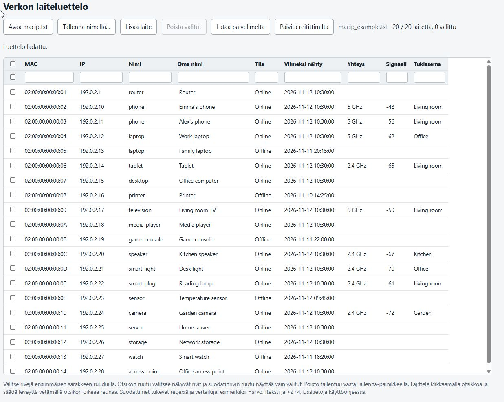

# MAC/IP Device Inventory

Maintain a network device inventory using data collected from ASUS and Huawei
routers. The project includes a local browser-based editor and a Home Assistant
panel. The user interface and detailed setup guides are currently in Finnish.



## Router compatibility

The router scripts have been tested with these models:

- ASUS RT-AC66U_B1 and RT-AX53U
- Huawei WA8021V5

Other models and firmware versions may expose different interfaces and are not
guaranteed to work. Supporting a different router may require a new script
similar to `asus_mac.py` or `huawei_lan_inventory.py`.

## Features

- Collect MAC and IP addresses, device names and status from configured routers.
- Edit names, add or delete devices, sort columns and filter the inventory.
- Run router updates from the editor and review new devices and IP changes.
- View estimated Wi-Fi connection information from ASUS routers when available.
- Optionally synchronize local device names to ASUS router nicknames.
- Fill empty local names from ASUS nicknames without overwriting existing names.

Router data can be stale, so the reported access point is an estimate, not
proof of a device's current connection. Updates run in the configured order;
later routers can overwrite values recorded by earlier ones. ASUS nickname
synchronization is enabled by default and changes router settings. Set
`sync_nicknames=false` in an ASUS router's configuration to disable writes
to the router. Importing names into empty local fields remains enabled.
When routers have different names, the first imported name is retained.

ASUS status reporting is approximate: `isOnline=1` is treated as an online
observation even for devices connected by cable or through another access
point. By default, `allow_online=true` marks these devices `Online` and
`set_offline=false` leaves other statuses unchanged.

For an ASUS-only setup, consider setting `set_offline=true` on the **first**
ASUS in `update_commands` and leaving `allow_online=true` on each ASUS. The
first successful update resets all existing statuses to `Offline`, then each
router marks its online observations `Online`. An offline or missing device
on a later router does not undo another router's online observation. Do not
enable `set_offline` on later routers, as that would erase earlier results.

These are estimates, not guaranteed current states: ASUS data can be stale.
If the first router fails, statuses are not reset; if a later router fails,
some devices can incorrectly remain offline. Set `allow_online=false` on a
router if its online observations should not change inventory status.

If another router provides more reliable status information for your network,
run it last. For example, with the tested Huawei setup, leave ASUS
`set_offline` at its default `false` and run Huawei last: it replaces the
ASUS status estimates and marks devices absent from its list as `--`
(unknown), not necessarily offline.

## Requirements

- Python 3.10 or later and the `requests` package for router scripts.
- A web browser for the local editor or a Home Assistant installation for the
  Home Assistant panel.
- Node.js is needed only for the JavaScript test.

Install `requests` into the Python environment used to run the router scripts:

```shell
python -m pip install requests
```

## Local setup

1. Create a separate `key=value` configuration file for each router.
   [huawei_config_example.txt](huawei_config_example.txt) is a Huawei example;
   replace the example address and credentials with your own. ASUS uses the
   same basic setting format but may have additional ASUS-specific settings,
   described in [macip_server_ohje.txt](macip_server_ohje.txt). The `macip`
   setting must point to the same
   `macip.txt` in the project directory for every router.
2. Edit [macip_server_config.json](macip_server_config.json) to list your
   router scripts and configuration files in the order they should run.
   Paths are relative to the project directory. For example:

   ```json
   {
     "update_commands": [
       ["asus_mac.py", "secret2.txt"],
       ["huawei_lan_inventory.py", "secret1.txt"]
     ]
   }
   ```

3. If you have an existing `macip.txt`, copy it into the project directory.
   Otherwise, you can create the inventory by running the router scripts
   individually, using each router's configuration file:

   ```shell
   python asus_mac.py secret2.txt
   python huawei_lan_inventory.py secret1.txt
   ```

   Alternatively, start the local server as described below. When the editor
   loads the inventory, the server creates a missing `macip.txt` with column
   headers. You can then use the editor's router update button to populate it.
   The server does not replace an existing file.
4. On Windows, run `macip.bat`. Alternatively, run
   `python macip_local_server.py`. The batch file opens a separate server
   window. Keep the server running while using the editor; it listens on
   `127.0.0.1:8765` and opens the editor in a browser. Stop it with Ctrl+C.

The router settings and inventory can contain credentials and personal network
information. Keep them private: `.gitignore` excludes files whose names contain
`secret` and files named `macip.txt`. Use secret filenames accordingly and
check what you are committing.

For detailed local editor, router configuration and ASUS diagnostic instructions,
see [macip_server_ohje.txt](macip_server_ohje.txt) (Finnish).

## Home Assistant

The Home Assistant integration provides an authenticated sidebar panel. For
installation, configuration and migration instructions, see
[the Home Assistant guide](home_assistant/custom_components/macip/README.md)
(Finnish). The Home Assistant integration creates an empty inventory with
headers when it is first opened if the file is missing.

## Tests

From the project directory:

```shell
python -m unittest discover -s tests
node tests/test_macip_filter.js
node tests/test_macip_navigation.js
```

## License

[MIT](LICENSE)
